# Awesome HTML · Fable 5.2 小游戏收藏

这是一批由 **Fable 5.2**（AI 辅助编程）在很短时间内生成的网页小游戏合集，题材涵盖开放世界、FPS、RTS、解谜、驾驶、体育、恐怖、仙侠等。技术栈以 Three.js / WebGL、Canvas 2D 与原生 JS 为主，不少作品被压缩成单个 HTML 文件。本仓库将可离线运行的版本归档到 [`games/`](games/)，封面图存于 [`screenshots/`](screenshots/)，并在每条下方注明原始来源与作者。

**收录**：26 款（本地离线归档 16 款，其余为在线演示或源码链接） · 数据快照：2026-11-12

## 离线运行说明

- `games/<编号>/` 为对应游戏的离线归档目录，入口为 `index.html`。

### 推荐方式：本地静态服务器（全部作品通用）

- 双击 `index.html` 以 `file://` 打开时，部分作品会被浏览器安全策略拦截。建议统一在仓库根目录起一个静态服务器：

  ```bash
  cd D:\html
  python -m http.server 8123
  # 浏览器打开 http://localhost:8123/games/<编号>/
  ```

- 或进入单个作品目录再起服务：

  ```bash
  cd games/17
  python -m http.server 8000
  # 浏览器打开 http://localhost:8000
  ```

### 为什么双击打不开（`file://` 限制）

- 以 `file://` 打开时，页面来源（origin）为 `null`，浏览器会拦截两类操作：
  1. **ES Module 脚本**（`<script type="module">`）：本地模块文件被 CORS 策略阻止加载；
  2. **运行时 `fetch` 本地文件**：`data/*.bin`、`assets/*.json`、模型/贴图/音频等本地资源同样被跨域拦截。
- 被拦截时控制台通常报 `origin 'null' ... blocked by CORS policy`，页面只剩空白画布；走 `http://localhost` 属同源请求，限制不再生效。

### 哪些必须用服务器、哪些可双击

- **必须通过本地服务器打开**：使用 ES Module，或运行时加载本地数据/模型的作品，如 02、10、16、17、19、23、26；双击会被浏览器拦截。
- **一般可直接双击**：纯内联单文件、经典 `<script>`、运行时不拉取本地资源的作品（如 00、06、07、20、22、25）；若个别浏览器仍拦截，改用服务器即可。

### 其他离线限制

- 多人联机（Node/WebSocket）、需摄像头或在线 AI 识别的作品无法完全离线，README 中已单独标注。
- 部分素材在作者源站已失效（404），归档时一并记录，不影响页面与主体结构留存。

## 游戏列表

### 00 · 几猫3A大作（几猫CS）

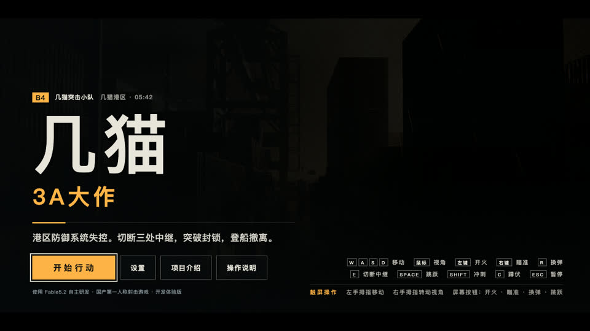

**中文**：Saltline 的全中文本地化重混：把雨夜集装箱港口 FPS 改头换面成了「几猫」货运站，玩法与氛围一脉相承，文案与美术全部中文化。

**EN**: A fully Chinese-localized remix of Saltline: a rain-soaked container-port FPS rebranded as the 几猫 shipping terminal.

<sub>类别：FPS · 语言：HTML · 全中文重混</sub>

[离线归档](games/00/) ｜ [在线试玩](https://fable52.games/play/jimao-cs)


### 01 · FOG CITY

**中文**：一款 three.js 开放世界探索项目，采用多文件 ES Module 组织、无构建步骤；目前未公开在线演示，仅能从源码仓库查看。

<sub>类别：开放世界 · 技术：three.js · 语言：JavaScript</sub>

[源码](https://github.com/Rikinshah787/Game-Fable-5.2)

*感谢作者 **@Rikinshah787** 的开源分享！*

### 02 · Dustfall

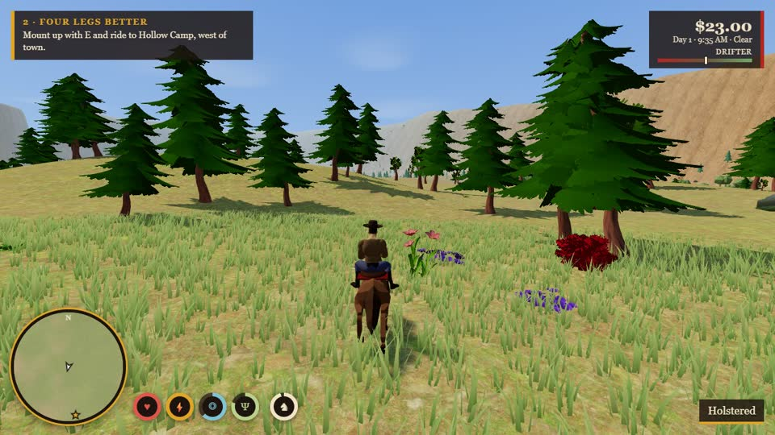

**中文**：原创西部开放世界：骑马驰骋、狩猎、钓鱼、打牌，在索雷尔盆地（Sorrel Basin）了结一段旧怨。

**EN**: An original open-world western: ride, hunt, fish, play cards and settle an old score in the Sorrel Basin.

<sub>类别：开放世界 · 技术：three.js 0.187 + Vite 8 · 语言：JavaScript · 体量：1.4 MB · 游玩量：443</sub>

[离线归档](games/02/) ｜ [在线试玩](https://fable52.games/play/dustfall) ｜ [作者演示站](https://dustfalls.netlify.app/) ｜ [源码](https://github.com/webKing021/dustfall)

*感谢作者 **@webKing021** 的开源分享！*

### 03 · Bayhaven

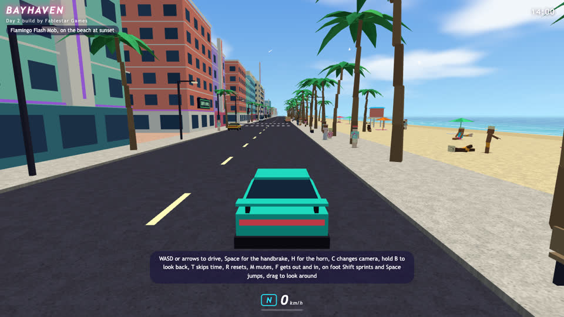

**中文**：一款开放世界犯罪题材游戏，由 Fable 5.2 在一次次自主会话中实时编写而成，偏展示与叙事向。

**EN**: An original open-world crime game written live by Fable 5.2, one autonomous session at a time.

<sub>类别：开放世界 · 技术：three.js · 语言：JavaScript · 体量：1.4 MB · 游玩量：482</sub>

[离线归档](games/03/) ｜ [在线试玩](https://fable52.games/play/bayhaven) ｜ [作者演示站](https://fablestar.games/watch.html) ｜ [源码](https://github.com/fablestar/bayhaven)

*感谢作者 **@fablestar** 的开源分享！*

### 04 · Aquila

**中文**：three.js + esbuild 打包的单文件 HTML 开放世界小游戏，与 05 同属一个随机生成仓库，暂未提供在线演示。

<sub>类别：开放世界 · 技术：three.js · 语言：HTML</sub>

[源码](https://github.com/GavinLOrio/Fable-5.2-random-game)

*感谢作者 **@GavinLOrio** 的开源分享！*

### 05 · Dawnward

**中文**：与 04 同仓库的另一款 esbuild 单文件 HTML 开放世界作品，暂未提供在线演示，仅见源码。

<sub>类别：开放世界 · 技术：three.js · 语言：HTML</sub>

[源码](https://github.com/GavinLOrio/Fable-5.2-random-game)

*感谢作者 **@GavinLOrio** 的开源分享！*

### 06 · Ironvale

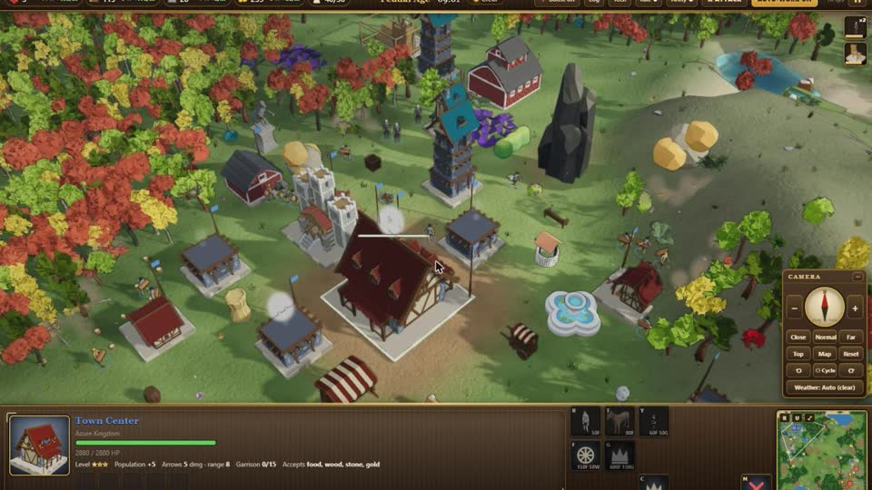

**中文**：3D 即时战略：采集资源、扩建基地、跨越三个时代，最终击败「绯红进军」（Crimson March）。

**EN**: A 3D real-time strategy game: gather, build, advance through three ages and defeat the Crimson March.

<sub>类别：RTS · 技术：three.js r128 · 语言：HTML · 体量：1.4 MB · 游玩量：353</sub>

[离线归档](games/06/) ｜ [在线试玩](https://fable52.games/play/ironvale) ｜ [作者演示站](https://sharpwizard.github.io/ironvale/) ｜ [源码](https://github.com/SharpWizard/ironvale)

*感谢作者 **@SharpWizard** 的开源分享！*

### 07 · Saltline

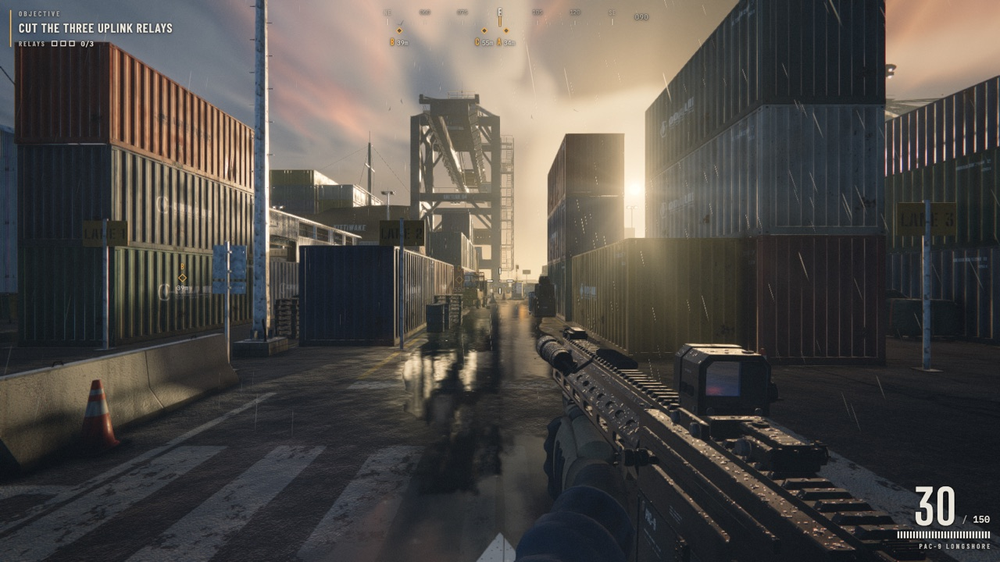

**中文**：初代「一句话提示」FPS：在雨夜笼罩的集装箱港口切断三个上行中继，同时躲避无人机与机器狗的猎杀，是掀起这波单提示 FPS 风潮的作品。

**EN**: The original one-prompt FPS: cut three uplink relays in a rainy container port while drones and robot dogs hunt you.

<sub>类别：FPS · 技术：three.js · 语言：HTML · 体量：1390KB · 游玩量：4.4k</sub>

[离线归档](games/07/) ｜ [在线试玩](https://fable52.games/play/saltline-fable-5-2-fps) ｜ [作者演示站](https://realcodebear.github.io/saltline-fable-5.2/) ｜ [源码](https://github.com/realcodebear/saltline-fable-5.2)

*感谢作者 **@realcodebear** 的开源分享！*

### 08 · 盐线行动 Online


**中文**：Saltline 的多人版：免费混战的港口枪战，5 秒快速复活；基于 Node 服务与 WebSocket，需联网对战，无法静态归档。

**EN**: Saltline goes multiplayer: a free-for-all online port shootout with 5-second respawns.

<sub>类别：FPS · 技术：three.js + WebSocket · 语言：JavaScript · 体量：1.4 MB · 游玩量：69</sub>

[在线试玩](https://fable52.games/play/saltline-online) ｜ [源码](https://github.com/wenzhengshi/fable5-2-salt-online)

*感谢作者 **@wenzhengshi** 的开源分享！*

### 09 · SUBLEVEL 07

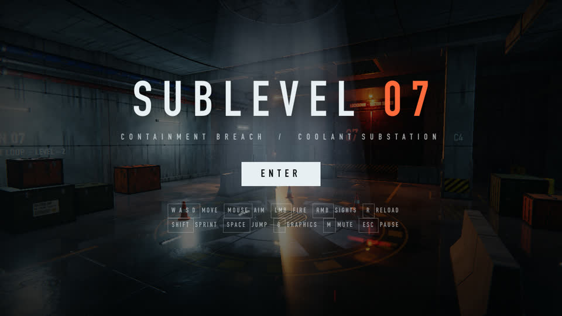

**中文**：一句话 FPS 提示、73 轮自主迭代、41 分钟成品：湿润反光的地面与三波悬浮无人机，全部压进一个 128KB 文件。

**EN**: A one-sentence FPS prompt, 73 autonomous turns, 41 minutes: wet reflective floors and three waves of hover drones in a 128 KB file.

<sub>类别：FPS · 技术：three.js · 语言：HTML · 体量：128 KB · 游玩量：331</sub>

[离线归档](games/09/) ｜ [在线试玩](https://fable52.games/play/sublevel-07-fps-repro) ｜ [作者演示站](https://wquguru.github.io/fable52-fps-repro/) ｜ [源码](https://github.com/wquguru/fable52-fps-repro)

*感谢作者 **@wquguru** 的开源分享！*

### 10 · BLAMELESS

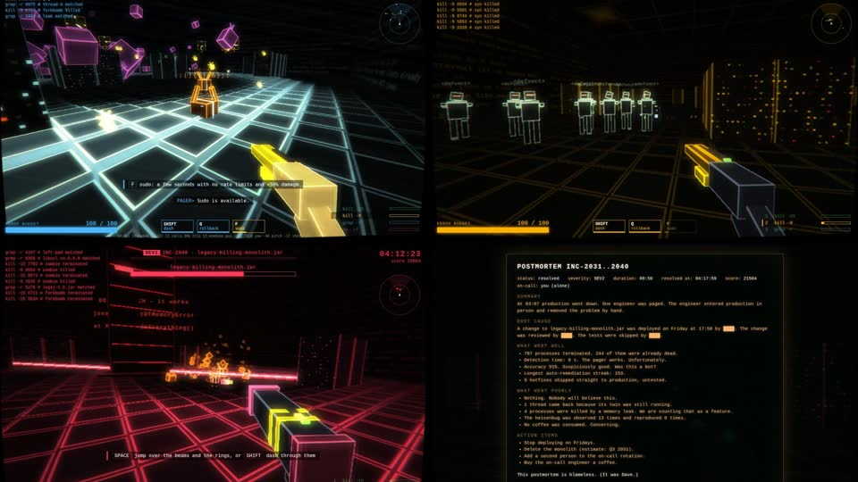

**中文**：值班运维题材射击：凌晨 3:07 生产挂了，你得亲自 kubectl exec 钻进生产环境排障。

**EN**: An on-call shooter: 03:07, prod is down, and you kubectl exec into production in person.

<sub>类别：FPS · 技术：three.js · 语言：JavaScript · 体量：1.4 MB · 游玩量：418</sub>

[离线归档](games/10/) ｜ [在线试玩](https://fable52.games/play/blameless) ｜ [作者演示站](https://blameless.petruha.ge/) ｜ [源码](https://github.com/Petyok/blameless)

*感谢作者 **@Petyok** 的开源分享！*

### 11 · Dustline Outpost

**中文**：three.js r128 制作，由 HTML、game.js 与资源目录组成；暂未提供在线演示，仅见源码仓库。

<sub>类别：FPS · 技术：three.js r128 · 语言：JavaScript</sub>

[源码](https://github.com/systemsluke/fable5.2game)

*感谢作者 **@systemsluke** 的开源分享！*

### 12 · Tidebell 潮钟

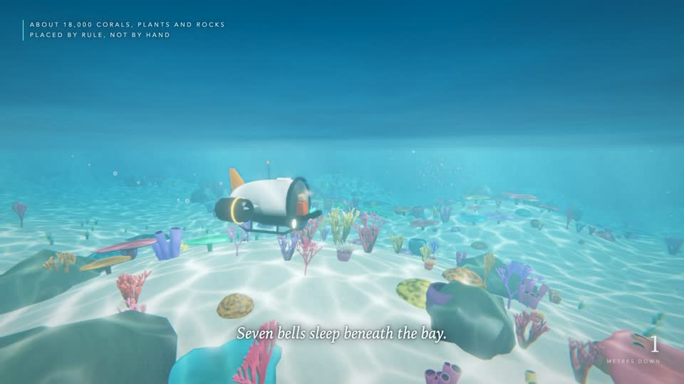

**中文**：驾驶一艘微型潜水器，从阳光明媚的礁潜向幽深海底，唤醒七口沉睡的潮钟。

**EN**: Pilot a tiny submersible from sunlit reefs to the abyss and wake seven sleeping tide bells.

<sub>类别：探索 · 技术：three.js r170 · 语言：HTML · 体量：3110KB · 游玩量：307</sub>

[在线试玩](https://fable52.games/play/tidebell) ｜ [源码](https://github.com/hahaliu1029/fable5.2demo)

*感谢作者 **@hahaliu1029** 的开源分享！*

### 13 · MOTHLIGHT // Vesper-9

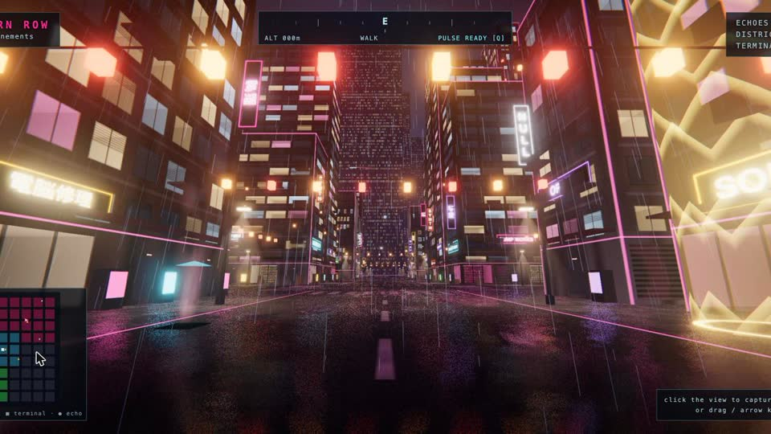

**中文**：在雨夜湿滑的赛博朋克城市街头竞速，穿越五个街区、闯过 12 道光门。

**EN**: Street racing through a rain-slick cyberpunk city: thread 12 light gates across five districts.

<sub>类别：驾驶 · 技术：three.js r170 · 语言：HTML · 体量：1144KB · 游玩量：594</sub>

[在线试玩](https://fable52.games/play/mothlight) ｜ [源码](https://github.com/hahaliu1029/fable5.2demo)

*感谢作者 **@hahaliu1029** 的开源分享！*

### 14 · 青云宗 · 御剑采灵

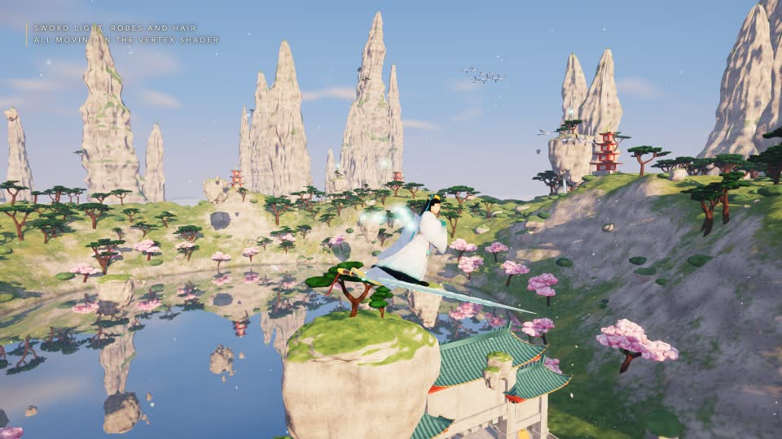

**中文**：第三人称御剑穿行于云海之上：收集 20 缕灵气，点亮山门，再御剑穿门而出。

**EN**: Third-person sword flight over a sea of clouds: gather 20 motes of qi, light the sect gate and fly through.

<sub>类别：仙侠 · 技术：three.js r170 · 语言：HTML · 体量：2248KB · 游玩量：383</sub>

[在线试玩](https://fable52.games/play/qingyun-sword-flight) ｜ [源码](https://github.com/hahaliu1029/fable5.2demo)

*感谢作者 **@hahaliu1029** 的开源分享！*

### 15 · MISREMEMBER

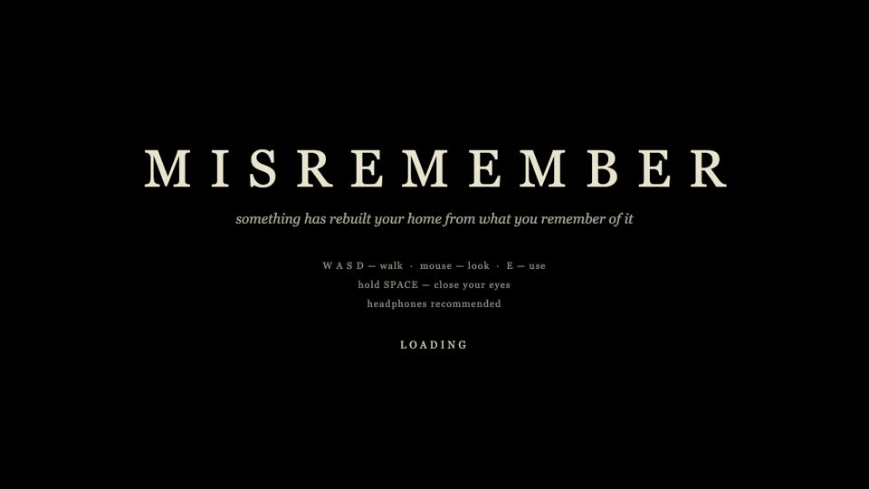

**中文**：某种东西依照你的记忆重建了童年故居，而只要你注视着，周遭就什么都不会改变——一款心理向恐怖小品。

**EN**: Something rebuilt your childhood home from your memory of it, and nothing changes while you're looking.

<sub>类别：恐怖 · 技术：three.js · 语言：HTML · 体量：11020KB · 游玩量：86</sub>

[在线试玩](https://fable52.games/play/misremember) ｜ [源码](https://github.com/hahaliu1029/fable5.2demo)

*感谢作者 **@hahaliu1029** 的开源分享！*

### 16 · Hanford Reach


**中文**：漫步哥伦比亚河畔一座小镇的废墟，是一款温馨聚落建造游戏送出的首个可玩关卡。

**EN**: Walk the ruins of a small river town on the Columbia: the first playable stage of a cozy settlement builder made as a gift.

<sub>类别：建造 · 技术：three.js + Vite · 语言：JavaScript · 体量：1.4 MB · 游玩量：110</sub>

[离线归档](games/16/) ｜ [在线试玩](https://fable52.games/play/hanford-reach) ｜ [作者演示站](https://settlement-bluff-fable52.vercel.app/) ｜ [源码](https://github.com/chzbloom123/settlement-bluff-fable5.2)

*感谢作者 **@chzbloom123** 的开源分享！*

### 17 · Boring Game


**中文**：基于真实地图数据的体素旧金山湾区：规划线路、挑选盾构机，再一层层打通审批流程。

**EN**: A voxel San Francisco Bay Area on real map data: plan the line, pick the boring machine, cut the red tape.

<sub>类别：建造 · 技术：three.js + Vite · 语言：TypeScript · 体量：1.4 MB · 游玩量：74</sub>

[离线归档](games/17/) ｜ [在线试玩](https://fable52.games/play/boring-game-sf-bay-transit) ｜ [作者演示站](https://jakozaur.github.io/sf_bay_area_transit_fable_5_2_game/) ｜ [源码](https://github.com/jakozaur/sf_bay_area_transit_fable_5_2_game)

*感谢作者 **@jakozaur** 的开源分享！*

### 18 · Soccer 3D


**中文**：七人制 3D 足球，配备裁判、越位、卡牌、点球与战术系统，全部装在一个 HTML 文件里。

**EN**: Seven-a-side 3D football with referees, offside, cards, penalties and tactics, in one HTML file.

<sub>类别：体育 · 技术：自绘 3D · 语言：HTML · 体量：1243KB · 游玩量：1.1k</sub>

[离线归档](games/18/) ｜ [在线试玩](https://fable52.games/play/pocket-soccer-3d) ｜ [作者演示站](https://shaunprice.github.io/soccer-3d/) ｜ [源码](https://github.com/ShaunPrice/soccer-3d)

*感谢作者 **@ShaunPrice** 的开源分享！*

### 19 · TukTuk

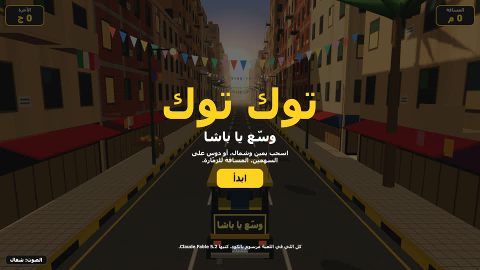

**中文**：驾驶突突车穿行拥挤的街头，闪躲小巴、出租车和满载西瓜的货车。原作界面为阿拉伯语，本离线归档已整体汉化为中文；图形与音效均由代码实时生成，无外部素材依赖。

**EN**: Weave a tuk-tuk through a crowded Egyptian street, dodging microbuses, taxis and watermelon pickups.

<sub>类别：驾驶 · 技术：three.js · 语言：JavaScript · 体量：40 KB · 游玩量：189</sub>

[离线归档](games/19/) ｜ [在线试玩](https://fable52.games/play/tuktuk) ｜ [作者演示站](https://basemazab.github.io/tuktuk/) ｜ [源码](https://github.com/basemazab/tuktuk)

*感谢作者 **@basemazab** 的开源分享！*

### 20 · Emberdeep

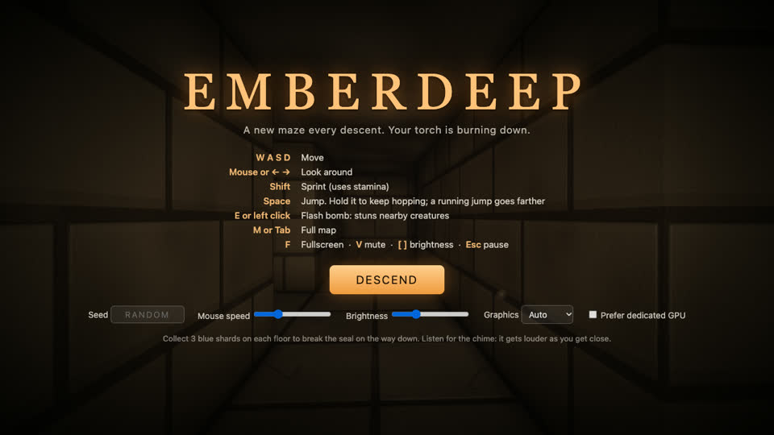

**中文**：第一人称地牢下行，而你的火炬正在燃尽：找到三块碎片、打破封印，继续往深处走，支持单人或结伴。

**EN**: A first-person dungeon descent where your torch is burning down: find three shards, break the seal, go deeper. Solo or with friends.

<sub>类别：冒险 · 技术：原生 · 语言：HTML · 体量：100KB · 游玩量：80</sub>

[离线归档](games/20/) ｜ [在线试玩](https://fable52.games/play/emberdeep) ｜ [作者演示站](https://dndnoob.github.io/EmberDeep/) ｜ [源码](https://github.com/DNDNoob/EmberDeep)

*感谢作者 **@DNDNoob** 的开源分享！*

### 21 · Daedalus


**中文**：从海底一路攀登到奥林匹斯，穿越 30 台古代机械构成的谜题，途中与六位神祇相遇。

**EN**: Climb from the sea floor to Olympus through 30 puzzles built on ancient machines, and meet six gods on the way.

<sub>类别：解谜 · 技术：原生 · 语言：HTML · 体量：121KB · 游玩量：105</sub>

[离线归档](games/21/) ｜ [在线试玩](https://fable52.games/play/daedalus) ｜ [作者演示站](https://s77ffy.github.io/daedalus/) ｜ [源码](https://github.com/S77FFY/daedalus)

*感谢作者 **@S77FFY** 的开源分享！*

### 22 · Sternenjäger

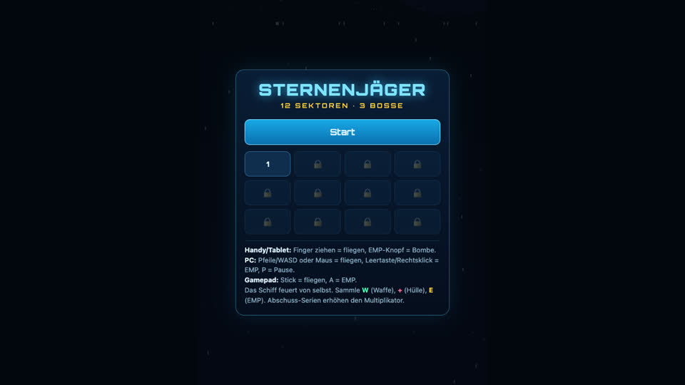

**中文**：科幻太空射击：12 个星域、3 场 Boss 战，全部封装在一个 HTML 文件里。

**EN**: A sci-fi space shooter with 12 sectors and 3 boss fights, all in one HTML file.

<sub>类别：射击 · 技术：原生 · 语言：HTML · 体量：40KB · 游玩量：90</sub>

[离线归档](games/22/) ｜ [在线试玩](https://fable52.games/play/sternenjaeger) ｜ [作者演示站](https://oldzitterhand.github.io/sternenjaeger/) ｜ [源码](https://github.com/oldzitterhand/sternenjaeger)

*感谢作者 **@oldzitterhand** 的开源分享！*

### 23 · Shuttle Strike


**中文**：第一人称羽毛球：调用摄像头追踪手部，完成握拍、挥拍与扣杀；手势识别依赖在线 Mediapipe，离线仅保留 3D 场景骨架。

**EN**: First-person badminton where your webcam tracks your hand: grip, swing, smash.

<sub>类别：体育 · 技术：three.js + 手部追踪 · 语言：HTML · 体量：70KB · 游玩量：81</sub>

[离线归档](games/23/) ｜ [在线试玩](https://fable52.games/play/shuttle-strike) ｜ [作者演示站](https://fedifianto.github.io/shuttlestrike/) ｜ [源码](https://github.com/fedifianto/shuttlestrike)

*感谢作者 **@fedifianto** 的开源分享！*

### 24 · NEON RUNNER

**中文**：Canvas 2D 跑酷小品，无构建、单文件 HTML；暂未提供在线演示，仅见源码仓库。

<sub>类别：跑酷 · 技术：Canvas 2D · 语言：HTML</sub>

[源码](https://github.com/Ilias-AK/NewGameFromFable5.2)

*感谢作者 **@Ilias-AK** 的开源分享！*

### 25 · Becario del Universo

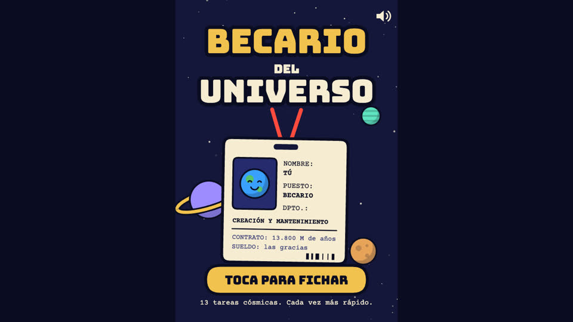

**中文**：老板去喝咖啡已经 138 亿年，你是撑着整个宇宙的无薪实习生：在手机或桌面应付一连串快节奏微任务。

**EN**: The Boss has gone for coffee for 13.8 billion years. You're the unpaid intern running the universe: rapid-fire micro-tasks on phone or desktop.

<sub>类别：休闲 · 技术：原生 · 语言：HTML · 体量：48KB · 游玩量：43</sub>

[离线归档](games/25/) ｜ [在线试玩](https://fable52.games/play/becario-del-universo) ｜ [作者演示站](https://masugus.github.io/fable5.2-5min-game/) ｜ [源码](https://github.com/masugus/fable5.2-5min-game)

*感谢作者 **@masugus** 的开源分享！*

### 26 · Harvest Standoff

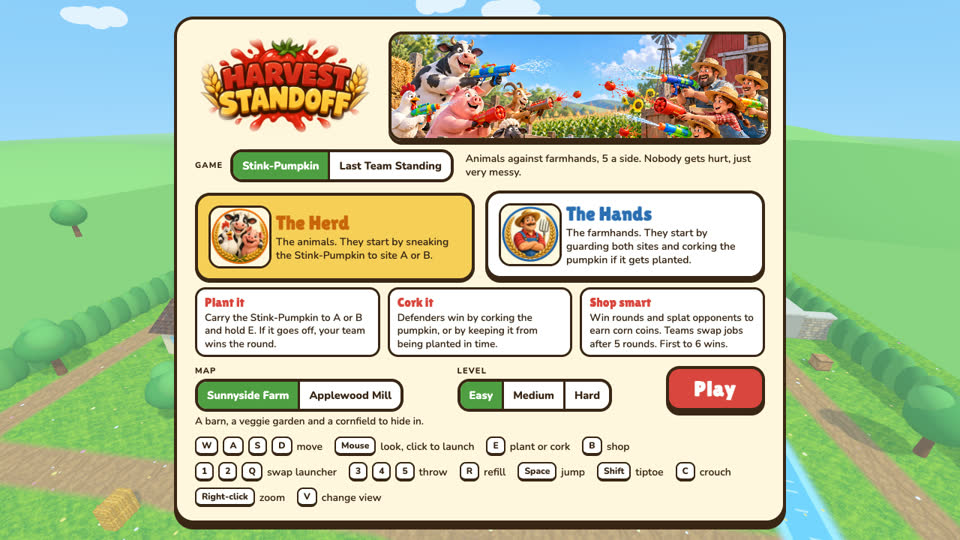

**中文**：老少皆宜的 5v5 农场对战：动物对阵农夫，还有臭南瓜登场，全程无人受伤。

**EN**: Kid-friendly 5v5 farm battles: animals versus farmhands, a Stink-Pumpkin, and nobody gets hurt.

<sub>类别：竞技 · 技术：three.js · 语言：JavaScript · 体量：1.4 MB · 游玩量：87</sub>

[离线归档](games/26/) ｜ [在线试玩](https://fable52.games/play/harvest-standoff) ｜ [作者演示站](https://harvest-standoff.vercel.app/) ｜ [源码](https://github.com/andreteow/farm-ca)

*感谢作者 **@andreteow** 的开源分享！*

## 归档与来源说明

- 游戏名称、源码仓库、平台页、演示站、技术栈与分类等原始字段见 [`games.csv`](games.csv)。
- 离线归档自作者公开演示站镜像；封面图来自 Fable 5.2 平台缩略图。版权与著作权归各原作者所有，本仓库仅作学习与收藏用途。
- 仅提供源码、暂无公开演示的条目（01 / 04 / 05 / 11 / 24），README 中仅保留源码链接。
- 08 为 Node + WebSocket 多人联机服务，12–15 的游戏本体由 Fable 平台流式提供、无独立公开演示站，均未做本地静态归档，仅保留封面图与在线 / 源码链接。
